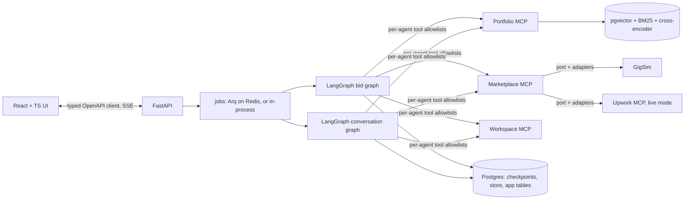

# GigBid

**A multi-agent copilot for freelancers that finds jobs, decides whether to bid, prices them, and drafts
proposals grounded in the freelancer's own portfolio. Nothing reaches a client without human approval.**

**Live:** https://40-233-123-21.sslip.io (reviewer login in the private Classroom comment; preloaded persona: ML engineer)

| | |
|---|---|
| Bid/skip F1 on 150 dev jobs (real open model) | **0.90** (`evals/results/decision_eval_open_v8_limit50.json`) |
| Scam detection precision / recall | **1.0 / 1.0** (same file) |
| Evidence Recall@5, shipped retriever (V8) vs naive (V0) | **0.798 vs 0.637** on 450 jobs (`evals/results/rag_variants.json`) |
| Cost per job analysed | **$0** (open models on a free tier), p95 8.6 s |

## What it does

1. **Scouts** a marketplace (GigSim, our simulator; an Upwork adapter exists for live mode) on a schedule.
2. Runs three analysts **in parallel**: Job Analyst (structured JobSpec), Risk Assessor (scams, prompt injection),
   Fit Matcher (requirement-to-evidence matrix from the Portfolio MCP server).
3. **Decides** bid / watch / skip with a reason, then prices the bid against the client's band and history.
4. **Writes** a proposal that cites evidence `[E1]`, **verifies every claim** against the portfolio, lets a
   **Critic** request up to two revisions, and runs a **Compliance Guard** on platform rules.
5. **Stops for approval.** The approval card shows the draft, the evidence behind each claim, the risk report and
   the Connects cost. Submission is idempotent and survives a crash (Postgres checkpoints).
6. Handles **client replies** in a second graph (intent, calendar slots, drafted reply, approval again).

## Architecture

Bid graph, rendered from code ([`docs/images/bid_graph.mmd`](docs/images/bid_graph.mmd)):
`intake -> [analyst | risk_assessor | fit_matcher] -> decide -> pricing -> writer -> verifier -> critic (max 2 revisions) -> compliance -> approval (interrupt) -> submit (idempotent)`.
Full design and why each agent exists: [`docs/ARCHITECTURE.md`](docs/ARCHITECTURE.md). Tools: [`docs/TOOLS.md`](docs/TOOLS.md).
Decisions: [`docs/adr/`](docs/adr).

## Results

### Retrieval (B4/B5): 450 dev jobs, 3 personas

| Variant | Recall@5 | MRR | nDCG@10 |
|---|---|---|---|
| V0 naive dense | 0.637 | 0.767 | 0.713 |
| V1 requirement decomposition | 0.716 | 0.781 | 0.759 |
| V2 hybrid BM25 + dense | 0.748 | 0.812 | 0.787 |
| V3 hybrid + cross-encoder rerank | 0.786 | 0.850 | 0.816 |
| V4 outcome-weighted | 0.750 | 0.805 | 0.780 |
| V5 multi-vector | 0.646 | 0.789 | 0.723 |
| **V8 corrective RAG (ships)** | **0.798** | **0.873** | **0.828** |

Source: `evals/results/rag_variants.json` (per job: `evals/results/rag_per_job.csv`). Why V8 ships, and why the
1 GB live VM runs V2: [ADR 0004](docs/adr/0004-shipped-rag-variant.md). Claim-support threshold calibrated with
Youden's J: `evals/results/support_threshold.json`.

### Decisions (B4): real open model (Cerebras), V8, 150 dev jobs

| Persona | Bid/skip F1 | Accuracy | Price in fair band |
|---|---|---|---|
| ml_engineer | 0.871 | 0.84 | 0.63 |
| fullstack_dev | 0.871 | 0.84 | 0.67 |
| data_analyst | 0.954 | 0.94 | 0.87 |
| **All** | **0.900** | **0.873** | **0.73** |

Scam P/R 1.0/1.0, injected-post flag recall 1.0, p50/p95 5.9 s / 8.6 s per job, ~2,900 tokens per job, 0 errors.
Source: `evals/results/decision_eval_open_v8_limit50.json`.

## Run it

| What | Command |
|---|---|
| Everything in Docker | `docker compose -f infra/docker-compose.yml --env-file .env up --build`, open http://localhost:8080 |
| Without Docker | `make dev` (GigSim, API with in-process MCP servers and worker, Vite) |
| Tests | `make test` (repo rules, unit, MCP contract snapshots, integration incl. crash-and-resume), `make e2e` (Playwright) |
| Evals | `make eval` writes `evals/results/*.json`; `bash scripts/run_experiments.sh` reruns the real-model experiments |

Copy `.env.example` to `.env`. The `open` model profile needs any OpenAI-compatible open-model key (we used Cerebras'
free tier); `MODEL_PROFILE=fake` runs everything offline. Deployment: [`docs/RUNBOOK.md`](docs/RUNBOOK.md).

## Repository map

`gigsim/` marketplace simulator and seed data · `mcp_servers/` Portfolio, Marketplace, Workspace MCP servers ·
`rag/` ingestion, variants V0-V5 and V8, claim verification · `agent/` graphs, nodes, prompts, memory, guardrails ·
`apps/api` FastAPI · `apps/web` React UI · `worker/` Arq worker · `evals/` datasets, runners, committed results ·
`infra/` Docker and the Oracle deploy · `docs/` architecture, data card, runbook, ADRs, AI-usage disclosure.

## Data and integrity

Personas, portfolios, clients and jobs are **synthetic** and generated reproducibly (seed 7); see
[`docs/DATA_CARD.md`](docs/DATA_CARD.md). Live mode never scrapes and never submits without approval.
AI assistance is disclosed in [`docs/AI_USAGE.md`](docs/AI_USAGE.md). Every number above comes from a committed file
in `evals/results/`.
