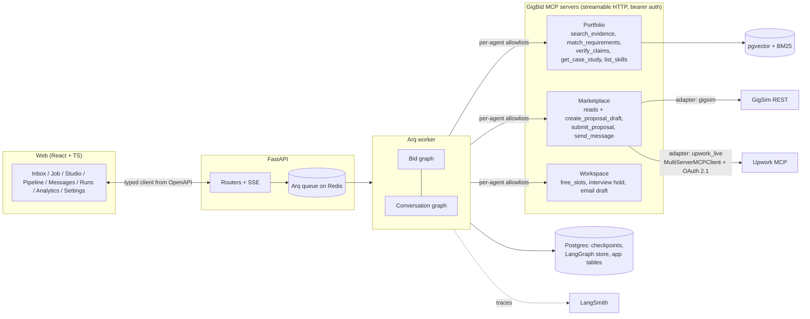
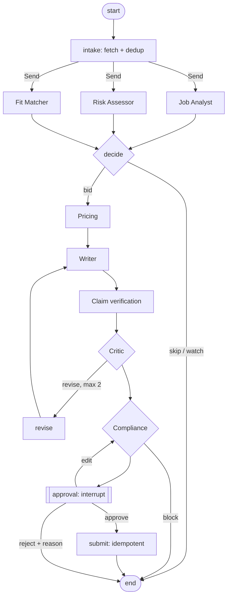

# Architecture

## Bid graph (one thread per job)

Rendered from code: [`docs/images/bid_graph.mmd`](images/bid_graph.mmd) (`agent/graphs/bid_graph.py`).

## Conversation graph (one thread per client conversation)

`load_thread -> classify intent -> plan_reply (calendar slots) -> draft_reply -> reply_compliance -> reply_approval [interrupt] -> send (+ tentative hold)`;
rendered: [`docs/images/conversation_graph.mmd`](images/conversation_graph.mmd).

## Why each agent exists

| Agent | Why it is separate | Model | Tools |
|---|---|---|---|
| Scout | Scheduling, dedup and rate-limit discipline belong outside any LLM | none | marketplace.search_jobs, get_job |
| Job Analyst | Turns a messy post into a JobSpec other steps can rely on | small | none |
| Risk Assessor | Scam and injection signals must be checked *before* anything is drafted; deterministic signals first, LLM only when ambiguous | small (rarely) | marketplace.get_client_history |
| Fit Matcher | Requirement-to-evidence matrix is the basis of both the decision and the proposal | none (retrieval) | portfolio.match_requirements |
| Pricing Strategist | Money and Connects decisions must be explainable arithmetic, not prose | none | pricing stats, client history, Connects, policy |
| Proposal Writer | The only creative step, gets the strongest model | large | portfolio evidence (via the matrix) |
| Claim verification | R5: grounding is checked by a different mechanism than the one that wrote the text | cross-encoder | portfolio.verify_claims |
| Critic | Personalisation, length, generic phrasing; bounded at 2 revisions | large | portfolio.get_case_study |
| Compliance Guard | Platform rules from config, can block with a visible reason | rules (+small) | marketplace.get_policy |
| Client Liaison | Conversations have different state and cadence than bids | small (intent) + large (reply) | threads, messages, workspace |

Analyst, Risk Assessor and Fit Matcher run in parallel (`Send`) and write disjoint state keys; the
`decide` node joins them.

## State, execution trace and long-term memory are kept apart (C2)

* **State** (`agent/state.py`): typed `TypedDict` with reducers for parallel writes; only what this job or
  conversation needs now. Persisted per thread by the Postgres checkpointer.
* **Execution trace**: every node appends a PII-masked entry (`trace`), every tool call is written to the
  append-only, hash-chained audit log of its MCP server, and the full run is in LangSmith. One trace id flows from the
  API request through the graph (`X-Trace-Id`) into every MCP server and audit line. The trace is for audit and
  debugging and is never fed back into prompts.
* **Long-term memory** (`agent/memory/`): LangGraph store namespaces per user. Edits and marketplace outcomes are
  stored as *observations*; only an explicit promotion rule (S1 for style, O1/O2 for outcomes) writes memory. The
  memory viewer in Settings shows the rule that admitted each item and lets the user delete it.

## The marketplace port (R1)

`agent/marketplace_port.py` is the single interface; the graph only ever calls Marketplace MCP tools.
The server picks a backend by config (`MARKETPLACE_MODE`): `adapters/gigsim.py` or `adapters/upwork_live.py`
(official Upwork MCP through `MultiServerMCPClient`, OAuth 2.1 with PKCE, tokens encrypted per user, tool names
mapped in `agent/config.yaml: marketplace.live_tool_map`). Switching to live mode changes one config value; no
graph, node or prompt code changes. In live mode `submit_proposal` never submits: the draft is created on Upwork and
the user confirms it there.

## Human in the loop (R4, C5)

`interrupt()` happens before any proposal submission, message send or Connects spend. The payload carries the draft,
the evidence behind every claim, the risk report, the price rationale and the `dry_run` preview with the Connects cost.
Approve, edit (diffed into style-memory observations and re-checked by Compliance) or reject with a reason. The
autonomy setting can auto-skip low-fit jobs but never auto-sends.
